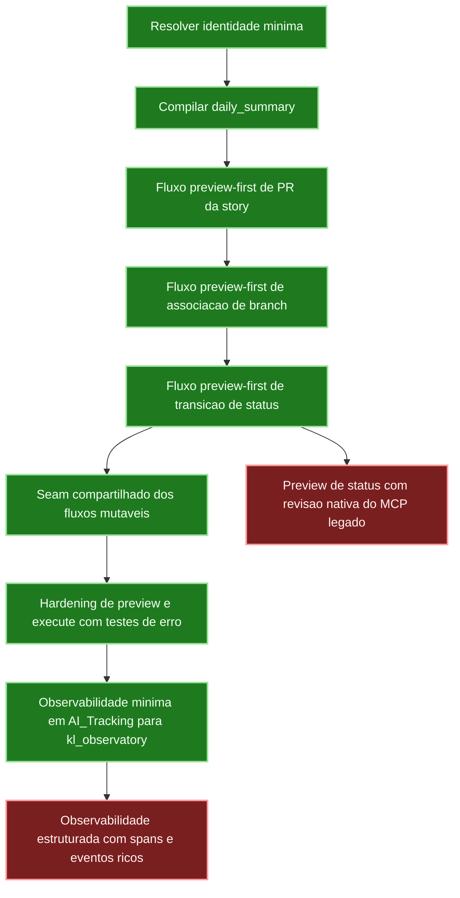

# KwikLedgers LangGraph Runtime

Repositório Python do runtime futuro de orquestração da KwikLedgers em
LangGraph.

Objetivos deste primeiro slice:
- manter o agente legado atual intocado
- abrir um seam tecnico para migracao incremental dos fluxos
- definir estado tipado e portas de integracao independentes do MCP atual
- compilar o primeiro subgrafo de `Daily Summary`

e notificacoes sejam plugados sem editar o runtime legado nesta fase.
Este repositório orquestra o runtime ativo: LangGraph é dono de processo,
aprovação e replay, enquanto FastMCP fornece as capabilities atômicas nativas.
O backend padrão é `fastmcp`; `legacy` existe somente como rollback temporário.

## Modo de repositorio standalone

O projeto foi estruturado para viver como um repositório próprio no GitHub.

- O codigo-fonte vive sob `kwikledgers_langgraph/`.
- A validacao basica vive sob `tests/`.
- O runtime legado da KwikLedgers e opcional e entra apenas por adapters de
	compatibilidade.
- Os adapters legados nao dependem mais de um caminho fixo do monorepo; eles
	aceitam configuracao explicita por variaveis de ambiente.

Variaveis de ambiente suportadas para compatibilidade com o runtime legado:

- `KWIKLEDGERS_MCP_SERVERS_PATH`: caminho absoluto para o diretorio
	`agent/mcp_servers` do workspace legado.
- `KWIKLEDGERS_LEGACY_ROOT`: caminho absoluto para o root do workspace legado;
	o adapter resolve `agent/mcp_servers` a partir dele.
- `KWIKLEDGERS_USER_EMAIL`: email explicito do usuario atual para o seam de identidade do runtime novo.
- `KWIKLEDGERS_USER_DISPLAY_NAME`: nome exibido do usuario atual quando a identidade for resolvida por ambiente.

## Estrutura inicial

- `kwikledgers_langgraph/state.py`: contrato tipado do estado compartilhado
- `kwikledgers_langgraph/adapters.py`: portas/protocolos para integracoes
- `kwikledgers_langgraph/legacy_adapters.py`: adapters de compatibilidade com o runtime atual
- `kwikledgers_langgraph/guardrails.py`: gates explicitos de aprovacao e classificacao de operacoes
- `kwikledgers_langgraph/observability.py`: correlation ID, run ID e timeline da execucao
- `kwikledgers_langgraph/graphs/mutable_flow.py`: seam compartilhado para fluxos mutaveis preview-first
- `kwikledgers_langgraph/graphs/daily_summary.py`: primeiro subgrafo
- `kwikledgers_langgraph/graphs/story_pull_request.py`: fluxo de preview/aprovacao/criacao de PR da story
- `kwikledgers_langgraph/graphs/story_branch_association.py`: fluxo de preview/aprovacao/associacao de branch da story
- `kwikledgers_langgraph/graphs/story_status_transition.py`: fluxo de preview/aprovacao/transicao de status da story
- `kwikledgers_langgraph/runtime.py`: fabrica de compilacao do runtime
- `kwikledgers_langgraph/cli.py`: entrypoint manual do novo runtime
- `kwikledgers_langgraph/story_pr_cli.py`: entrypoint dedicado ao fluxo de PR da story
- `kwikledgers_langgraph/story_branch_cli.py`: entrypoint dedicado ao fluxo de associacao de branch da story
- `kwikledgers_langgraph/story_status_cli.py`: entrypoint dedicado ao fluxo de transicao de status da story

## Execucao manual

Instale as dependencias do ambiente com Poetry:

```bash
poetry install
```

Quando as dependencias declaradas em `pyproject.toml` mudarem, regenere e versione
tambem o `poetry.lock`:

```bash
poetry lock
```

```bash
poetry run kwikledgers-langgraph --help
```

```bash
poetry run kwikledgers-langgraph-story-pr --help
```

```bash
poetry run kwikledgers-langgraph-story-branch --help
```

```bash
poetry run kwikledgers-langgraph-story-status --help
```

## Fechamento de tarefas

A única exceção autônoma de escrita no Azure é o fluxo `day_end_closure`:
lançamento de horas e fechamento da task; se houver trabalho pendente às 18h,
criação de uma task de continuação. As demais operações mantêm aprovação prévia.

```bash
poetry install --extras legacy
poetry run python -m kwikledgers_langgraph.day_end_closure_cli --trigger manual --timezone America/Sao_Paulo --dry-run
bash scripts/register-day-end-closure.sh
```

O agendamento roda de segunda a sexta às 18h, no horário de São Paulo, e exige
WSL e cron ativos. O comando da extensão **KwikLedgers: Fechamento de Fim de Dia
(manual)** oferece dry run ou execução. Sem atividade vinculada à task, o fluxo
não lança horas; várias tasks ativas sem seleção explícita impedem o fechamento.

O hook de conclusão exige testes aprovados, evidência separada de trabalho e
evento da mesma sessão. Usa o horário registrado da conclusão e bloqueia sessões
de implementação somente local. Atualização atômica com revisão e journal local
evita repetir lançamentos. Falhas parciais exigem conferência antes de nova escrita.

Na extensão, alertas de ociosidade estão habilitados. A continuação usa apenas
arquivos locais, sem commit, push, PR ou alteração no Azure.

## Validacao rapida

```bash
poetry run python -m unittest discover -s tests
```

## Interface visual (LangGraph Studio local)

O projeto usa um único ambiente Poetry (Python 3.11+) que já inclui
`langgraph-cli[inmem]` como dependência declarada em `pyproject.toml`. O
Studio local sobe direto pelo mesmo `.venv` do projeto, sem venv separado,
e usa apenas ports mockados (nunca os adapters legados reais) definidos em
`kwikledgers_langgraph/dev_studio.py`.

Passos:

```bash
poetry install
poetry run langgraph dev
```

Isso sobe um servidor local com os grafos declarados em `langgraph.json`
(`daily_summary`, `story_pull_request`, `story_branch_association`,
`story_status_transition`), usando ports mockados definidos em
`kwikledgers_langgraph/dev_studio.py` (nunca os adapters legados reais).
O terminal mostra a URL do Studio (`https://smith.langchain.com/studio/?baseUrl=http://127.0.0.1:8123`)
para abrir a UI interativa no navegador.

## Roadmap Visual



- Verde: slices implementados e validados.
- Vermelho: backlog restante relevante.

Para executar com compatibilidade legada, o runtime novo importa os servidores
atuais apenas como adapters e sem modificar nenhum arquivo do runtime legado.

Exemplo:

```bash
export KWIKLEDGERS_LEGACY_ROOT=/path/to/legacy/workspace
poetry run kwikledgers-langgraph --disable-notifications
```

## Guardrails e observabilidade

O runtime novo agora registra em codigo:
- classificacao explicita das operacoes por tipo
- decisao de guardrail para cada etapa do fluxo
- `correlation_id` e `active_run_id` por execucao
- timeline de eventos por node no estado compartilhado
- emissao opcional de um resumo operacional em `AI_Tracking/Metrics/ai-usage-log.md`, consumivel pelo `kl_observatory`

O fluxo `daily_summary` agora tambem aceita um seam real de identidade:
- preserva `user_identity` quando ela ja vem do estado
- tenta resolver apenas nome e email explicitamente fornecidos por adapter configurado
- evita persistir email bruto em tracking e timeline, registrando apenas flags operacionais sobre a resolucao

As operacoes mutaveis de Azure ficam reservadas para fluxos futuros com
aprovacao explicita; o `Daily Summary` atual e classificado como fluxo sem
mutacao Azure, mas ja passa pela mesma camada de guardrails.

O primeiro fluxo mutavel agora existe para PR de story, mas segue preview-first:
- o preview da PR e sempre executado como leitura
- o runtime emite um `pending_approval` com `request_id` proprio para o preview atual
- a criacao da PR so segue quando uma `approval_confirmation` separada reaproveita esse `request_id`, o preview anterior e o `active_run_id` da execucao
- a CLI operacional nunca emite aprovacao automatica; a retomada exige confirmacao humana vinculada ao estado salvo

O fluxo de associacao de branch da story segue o mesmo contrato preview-first:
- o preview da associacao sempre roda como leitura
- o runtime persiste `branch_association_preview`, `pending_approval.request_id` e `observability.active_run_id`
- a associacao real so acontece quando uma retomada explicita usa o mesmo arquivo de estado salvo e o mesmo `request_id`
- a CLI operacional exige retomada com confirmacao humana para executar a associacao

O fluxo de transicao de status da story segue o mesmo contrato preview-first:
- o preview da transicao sempre roda como leitura e valida a proxima etapa do fluxo canonico
- o runtime persiste `story_status_preview`, `pending_approval.request_id` e `observability.active_run_id`
- a execucao real revalida status atual e revisao sintetizada antes de aplicar a mudanca
- a CLI operacional exige retomada com confirmacao humana para executar a transicao

Os tres fluxos mutaveis agora compartilham o mesmo seam interno:
- validacao minima de request obrigatorio
- preview read-only com tratamento uniforme de falha de adapter
- approval gate padronizado com `request_id`, `preview` e `active_run_id`
- execute com tratamento uniforme de falha e resultado operacional minimo

Os estados salvos de fluxos mutáveis exigem `KWIKLEDGERS_LANGGRAPH_STATE_SIGNING_KEY`:
- previews e retomadas são persistidos em envelope HMAC-SHA256
- branch, PR, status e fechamento não aceitam arquivo mutável sem assinatura
- as flags `--approve-*` não fazem parte da superfície operacional; a simulação existe apenas nos testes diretos de grafo

Quando um backend FastMCP mutável estiver ativo, o LangGraph emite uma capability HMAC curta após o approval gate. Ela vincula a tool FastMCP, o digest do payload, o `request_id`, o `active_run_id` e a expiração; o FastMCP apenas valida esse vínculo antes de executar a primitiva atômica.

Observabilidade externa minima:
- por padrao, as CLIs gravam um resumo curto da execucao em `AI_Tracking/Metrics/ai-usage-log.md`
- esse resumo reaproveita o formato que o `kl_observatory` ja parseia, sem acoplar o runtime ao banco/API do observatory
- use `--disable-observability-sync` quando quiser rodar a CLI sem emitir esse evento externo

Fluxo operacional da CLI de PR da story:

```bash
poetry run kwikledgers-langgraph-story-pr \
	--story-id 120204 \
	--repository-name accounting \
	--source-branch feature/KL-120204-balance-sheet-by-class \
	--what-was-changed "Resumo formal da alteracao" \
	--affected-processes "Fluxo de PR da story" \
	--expected-impacts "Maior previsibilidade do runtime" \
	--important-points "Validar preview e aprovacao" \
	--mermaid-diagram "graph TD; A-->B;" \
	--save-state-file /tmp/story-pr-preview.json \
	--print-state
```

- o primeiro comando gera o preview e grava o estado final completo, incluindo `pull_request_preview`, `pending_approval.request_id` e `observability.active_run_id`
- a aprovacao humana deve acontecer fora do runtime e referenciar o `request_id` exibido no estado salvo

```bash
poetry run kwikledgers-langgraph-story-pr \
	--resume-state-file /tmp/story-pr-preview.json \
	--approval-request-id REQUEST_ID_APROVADO \
	--save-state-file /tmp/story-pr-final.json \
	--print-state
```

- o segundo comando reaproveita o mesmo estado serializado para preservar preview, `request_id` e `active_run_id`
- a retomada real depende desse mesmo arquivo de estado; reiniciar a CLI com um estado novo invalida o vinculo exigido pelo guardrail

Fluxo operacional da CLI de associacao de branch da story:

```bash
poetry run kwikledgers-langgraph-story-branch \
	--story-id 120204 \
	--repository-name accounting \
	--source-branch feature/KL-120204-balance-sheet-by-class \
	--save-state-file /tmp/story-branch-preview.json \
	--print-state
```

- o primeiro comando gera o preview e grava o estado final com `branch_association_preview`, `pending_approval.request_id` e `observability.active_run_id`

```bash
poetry run kwikledgers-langgraph-story-branch \
	--resume-state-file /tmp/story-branch-preview.json \
	--approval-request-id REQUEST_ID_APROVADO \
	--save-state-file /tmp/story-branch-final.json \
	--print-state
```

- a retomada da associacao real exige o mesmo arquivo de estado e o `request_id` aprovado externamente

Fluxo operacional da CLI de transicao de status da story:

```bash
poetry run kwikledgers-langgraph-story-status \
	--story-id 120204 \
	--target-status "Aguardando PR" \
	--expected-current-status "Desenvolvimento" \
	--save-state-file /tmp/story-status-preview.json \
	--print-state
```

- o primeiro comando gera o preview e grava o estado final com `story_status_preview`, `pending_approval.request_id` e `observability.active_run_id`

```bash
poetry run kwikledgers-langgraph-story-status \
	--resume-state-file /tmp/story-status-preview.json \
	--approval-request-id REQUEST_ID_APROVADO \
	--save-state-file /tmp/story-status-final.json \
	--print-state
```

- a retomada da transicao real exige o mesmo arquivo de estado e o `request_id` aprovado externamente

## Proximo passo natural

Evoluir a emissao de observabilidade minima para sinais mais ricos no stack,
sem perder o contrato enxuto de preview, tracking e timeline.

## Processos de Lifecycle

Os novos processos são isolados dos builders e CLIs legados. Nenhum backend
Azure, git, FastMCP ou executor de código está conectado automaticamente.
Os testes adicionados ainda precisam de execução; mocks não comprovam paridade
operacional com o agente legado.

Builders públicos:

- `graphs.story_lifecycle.build_story_start_graph(ports, checkpointer=...)`:
	horário local primeiro, prévia de atribuição/Area/Active, aprovação humana,
	seleção de feature/hotfix, prévia e aprovação da branch a partir do HEAD
	remoto de stage-pre-prod, associação aprovada do pai e das children.
- `graphs.story_lifecycle.build_story_completion_graph(ports, checkpointer=...)`:
	vínculos aprovados, prévia e aprovação da PR Draft usando template/Mermaid,
	URL direta no resultado, nova aprovação independente de Aguardando PR.
- `graphs.task_lifecycle.build_task_cycle_graph(ports, checkpointer=...)`:
	evidência de início concluído, plano aprovado, implementação, testes,
	commit aprovado, horário de fechamento, horas com ceil e aprovação,
	prévia e aprovação independentes de Closed. Remaining Work não é enviado.
- `graphs.technical_debt_preparation.build_technical_debt_preparation_graph(ports)`:
	similaridade, contexto local, HTML seguro, Fibonacci, prévia completa de
	pai/filhas e cache quando houver indício de implementação. Não cria itens.
- `graphs.process_snapshot.build_process_snapshot_graph(ports)`:
	separação técnico/frontend/operacional, bloqueios/devoluções, todos os tipos
	e estados de tasks, e recomendações de cadência de prazos. Não agenda nem
	envia notificações.

As três orquestrações mutáveis também estão no registry independente
`lifecycle_runtime.LIFECYCLE_BUILDERS`; a fábrica é `build_lifecycle_runtime`.
Não houve alteração do registry existente de runtime, das CLIs ou do Studio.

Exemplo de ida e retomada, com portas e checkpointer fornecidos pelo host:

```python
from langgraph.types import Command
from kwikledgers_langgraph.lifecycle_runtime import build_lifecycle_runtime

graph = build_lifecycle_runtime("story_start", ports, checkpointer=trusted_checkpointer)
config = {"configurable": {"thread_id": authorized_thread_id}}
result = graph.invoke({"request": {
		"story_id": story_id,
		"task_id": child_id,
		"repository_name": repository_name,
}}, config)
pending = result["pending_approval"]
result = graph.invoke(Command(resume=authenticated_human_receipt), config)
```

Após a aprovação de Active, a próxima interrupção solicita a seleção explícita:
`graph.invoke(Command(resume="feature"), config)` ou `"hotfix"`. Os próximos
gates exigem recibos novos vinculados às respectivas prévias. Uma rejeição
encerra o processo; não há aprovação automática nem bypass de produção.

`LifecyclePorts`, `TechnicalDebtPreparationPorts` e `ProcessSnapshotPorts`
estão em `adapters.py`. O host deve implementar autenticação/autorização de
threads e recibos, revalidação CAS, allowlist de repositórios, planos confiáveis,
idempotência por chave e tracking durável em AI_Tracking. `MemorySaver` serve
para testes locais, não para persistência operacional.

```bash
poetry run python -m unittest discover -s tests -p 'test_lifecycle*.py'
poetry run python -m unittest discover -s tests -p 'test_process_policy.py'
poetry run python -m unittest discover -s tests
```