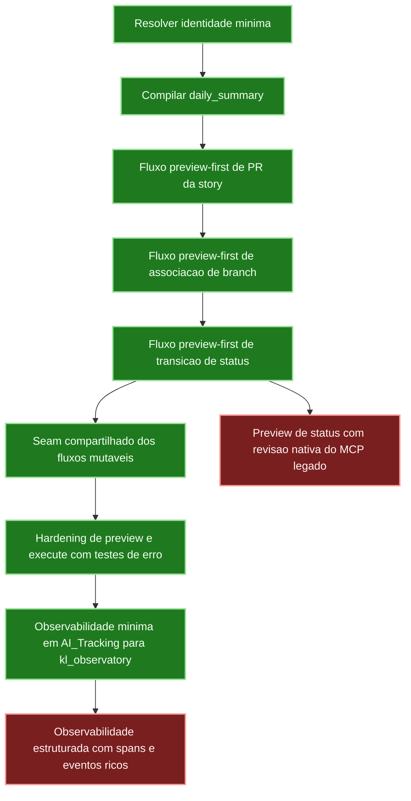

# KwikLedgers LangGraph Runtime

Repositório Python do runtime futuro de orquestração da KwikLedgers em
LangGraph.

Objetivos deste primeiro slice:
- manter o agente legado atual intocado
- abrir um seam tecnico para migracao incremental dos fluxos
- definir estado tipado e portas de integracao independentes do MCP atual
- compilar o primeiro subgrafo de `Daily Summary`

Este repositório ainda nao substitui o runtime atual por completo. Ele define a
base do novo runtime em LangGraph para que os adapters de Azure, tracking local
e notificacoes sejam plugados sem editar o runtime legado nesta fase.

## Modo de repositorio standalone

O projeto foi estruturado para viver como um repositório próprio no GitHub.

- O codigo-fonte vive sob `kwikledgers_langgraph/`.
- A validacao basica vive sob `tests/`.
- O runtime legado da KwikLedgers e opcional e entra apenas por adapters de
	compatibilidade.
- Os adapters legados nao dependem mais de um caminho fixo do monorepo; eles
	aceitam configuracao explicita por variaveis de ambiente.

Variaveis de ambiente suportadas para compatibilidade com o runtime legado:

- `KWIKLEDGERS_MCP_SERVERS_PATH`: caminho absoluto para o diretorio
	`agent/mcp_servers` do workspace legado.
- `KWIKLEDGERS_LEGACY_ROOT`: caminho absoluto para o root do workspace legado;
	o adapter resolve `agent/mcp_servers` a partir dele.
- `KWIKLEDGERS_USER_EMAIL`: email explicito do usuario atual para o seam de identidade do runtime novo.
- `KWIKLEDGERS_USER_DISPLAY_NAME`: nome exibido do usuario atual quando a identidade for resolvida por ambiente.

## Estrutura inicial

- `kwikledgers_langgraph/state.py`: contrato tipado do estado compartilhado
- `kwikledgers_langgraph/adapters.py`: portas/protocolos para integracoes
- `kwikledgers_langgraph/legacy_adapters.py`: adapters de compatibilidade com o runtime atual
- `kwikledgers_langgraph/guardrails.py`: gates explicitos de aprovacao e classificacao de operacoes
- `kwikledgers_langgraph/observability.py`: correlation ID, run ID e timeline da execucao
- `kwikledgers_langgraph/graphs/mutable_flow.py`: seam compartilhado para fluxos mutaveis preview-first
- `kwikledgers_langgraph/graphs/daily_summary.py`: primeiro subgrafo
- `kwikledgers_langgraph/graphs/story_pull_request.py`: fluxo de preview/aprovacao/criacao de PR da story
- `kwikledgers_langgraph/graphs/story_branch_association.py`: fluxo de preview/aprovacao/associacao de branch da story
- `kwikledgers_langgraph/graphs/story_status_transition.py`: fluxo de preview/aprovacao/transicao de status da story
- `kwikledgers_langgraph/runtime.py`: fabrica de compilacao do runtime
- `kwikledgers_langgraph/cli.py`: entrypoint manual do novo runtime
- `kwikledgers_langgraph/story_pr_cli.py`: entrypoint dedicado ao fluxo de PR da story
- `kwikledgers_langgraph/story_branch_cli.py`: entrypoint dedicado ao fluxo de associacao de branch da story
- `kwikledgers_langgraph/story_status_cli.py`: entrypoint dedicado ao fluxo de transicao de status da story

## Execucao manual

Instale as dependencias do ambiente com Poetry:

```bash
poetry install
```

Quando as dependencias declaradas em `pyproject.toml` mudarem, regenere e versione
tambem o `poetry.lock`:

```bash
poetry lock
```

```bash
poetry run kwikledgers-langgraph --help
```

```bash
poetry run kwikledgers-langgraph-story-pr --help
```

```bash
poetry run kwikledgers-langgraph-story-branch --help
```

```bash
poetry run kwikledgers-langgraph-story-status --help
```

## Validacao rapida

```bash
poetry run python -m unittest discover -s tests
```

## Interface visual (LangGraph Studio local)

O projeto usa um único ambiente Poetry (Python 3.11+) que já inclui
`langgraph-cli[inmem]` como dependência declarada em `pyproject.toml`. O
Studio local sobe direto pelo mesmo `.venv` do projeto, sem venv separado,
e usa apenas ports mockados (nunca os adapters legados reais) definidos em
`kwikledgers_langgraph/dev_studio.py`.

Passos:

```bash
poetry install
poetry run langgraph dev
```

Isso sobe um servidor local com os grafos declarados em `langgraph.json`
(`daily_summary`, `story_pull_request`, `story_branch_association`,
`story_status_transition`), usando ports mockados definidos em
`kwikledgers_langgraph/dev_studio.py` (nunca os adapters legados reais).
O terminal mostra a URL do Studio (`https://smith.langchain.com/studio/?baseUrl=http://127.0.0.1:8123`)
para abrir a UI interativa no navegador.

## Roadmap Visual



- Verde: slices implementados e validados.
- Vermelho: backlog restante relevante.

Para executar com compatibilidade legada, o runtime novo importa os servidores
atuais apenas como adapters e sem modificar nenhum arquivo do runtime legado.

Exemplo:

```bash
export KWIKLEDGERS_LEGACY_ROOT=/path/to/legacy/workspace
poetry run kwikledgers-langgraph --disable-notifications
```

## Guardrails e observabilidade

O runtime novo agora registra em codigo:
- classificacao explicita das operacoes por tipo
- decisao de guardrail para cada etapa do fluxo
- `correlation_id` e `active_run_id` por execucao
- timeline de eventos por node no estado compartilhado
- emissao opcional de um resumo operacional em `AI_Tracking/Metrics/ai-usage-log.md`, consumivel pelo `kl_observatory`

O fluxo `daily_summary` agora tambem aceita um seam real de identidade:
- preserva `user_identity` quando ela ja vem do estado
- tenta resolver apenas nome e email explicitamente fornecidos por adapter configurado
- evita persistir email bruto em tracking e timeline, registrando apenas flags operacionais sobre a resolucao

As operacoes mutaveis de Azure ficam reservadas para fluxos futuros com
aprovacao explicita; o `Daily Summary` atual e classificado como fluxo sem
mutacao Azure, mas ja passa pela mesma camada de guardrails.

O primeiro fluxo mutavel agora existe para PR de story, mas segue preview-first:
- o preview da PR e sempre executado como leitura
- o runtime emite um `pending_approval` com `request_id` proprio para o preview atual
- a criacao da PR so segue quando uma `approval_confirmation` separada reaproveita esse `request_id`, o preview anterior e o `active_run_id` da execucao
- o CLI dedicado aceita `--approve-create` apenas como simulacao local apos o preview,
	nao como aprovacao real de producao

O fluxo de associacao de branch da story segue o mesmo contrato preview-first:
- o preview da associacao sempre roda como leitura
- o runtime persiste `branch_association_preview`, `pending_approval.request_id` e `observability.active_run_id`
- a associacao real so acontece quando uma retomada explicita usa o mesmo arquivo de estado salvo e o mesmo `request_id`
- o CLI dedicado aceita `--approve-association` apenas como simulacao local para teste

O fluxo de transicao de status da story segue o mesmo contrato preview-first:
- o preview da transicao sempre roda como leitura e valida a proxima etapa do fluxo canonico
- o runtime persiste `story_status_preview`, `pending_approval.request_id` e `observability.active_run_id`
- a execucao real revalida status atual e revisao sintetizada antes de aplicar a mudanca
- o CLI dedicado aceita `--approve-transition` apenas como simulacao local para teste

Os tres fluxos mutaveis agora compartilham o mesmo seam interno:
- validacao minima de request obrigatorio
- preview read-only com tratamento uniforme de falha de adapter
- approval gate padronizado com `request_id`, `preview` e `active_run_id`
- execute com tratamento uniforme de falha e resultado operacional minimo

Observabilidade externa minima:
- por padrao, as CLIs gravam um resumo curto da execucao em `AI_Tracking/Metrics/ai-usage-log.md`
- esse resumo reaproveita o formato que o `kl_observatory` ja parseia, sem acoplar o runtime ao banco/API do observatory
- use `--disable-observability-sync` quando quiser rodar a CLI sem emitir esse evento externo

Fluxo operacional da CLI de PR da story:

```bash
poetry run kwikledgers-langgraph-story-pr \
	--story-id 120204 \
	--repository-name accounting \
	--source-branch feature/KL-120204-balance-sheet-by-class \
	--what-was-changed "Resumo formal da alteracao" \
	--affected-processes "Fluxo de PR da story" \
	--expected-impacts "Maior previsibilidade do runtime" \
	--important-points "Validar preview e aprovacao" \
	--mermaid-diagram "graph TD; A-->B;" \
	--save-state-file /tmp/story-pr-preview.json \
	--print-state
```

- o primeiro comando gera o preview e grava o estado final completo, incluindo `pull_request_preview`, `pending_approval.request_id` e `observability.active_run_id`
- a aprovacao humana deve acontecer fora do runtime e referenciar o `request_id` exibido no estado salvo

```bash
poetry run kwikledgers-langgraph-story-pr \
	--resume-state-file /tmp/story-pr-preview.json \
	--approval-request-id REQUEST_ID_APROVADO \
	--save-state-file /tmp/story-pr-final.json \
	--print-state
```

- o segundo comando reaproveita o mesmo estado serializado para preservar preview, `request_id` e `active_run_id`
- a retomada real depende desse mesmo arquivo de estado; reiniciar a CLI com um estado novo invalida o vinculo exigido pelo guardrail

Fluxo operacional da CLI de associacao de branch da story:

```bash
poetry run kwikledgers-langgraph-story-branch \
	--story-id 120204 \
	--repository-name accounting \
	--source-branch feature/KL-120204-balance-sheet-by-class \
	--save-state-file /tmp/story-branch-preview.json \
	--print-state
```

- o primeiro comando gera o preview e grava o estado final com `branch_association_preview`, `pending_approval.request_id` e `observability.active_run_id`

```bash
poetry run kwikledgers-langgraph-story-branch \
	--resume-state-file /tmp/story-branch-preview.json \
	--approval-request-id REQUEST_ID_APROVADO \
	--save-state-file /tmp/story-branch-final.json \
	--print-state
```

- a retomada da associacao real exige o mesmo arquivo de estado e o `request_id` aprovado externamente

Fluxo operacional da CLI de transicao de status da story:

```bash
poetry run kwikledgers-langgraph-story-status \
	--story-id 120204 \
	--target-status "Aguardando PR" \
	--expected-current-status "Desenvolvimento" \
	--save-state-file /tmp/story-status-preview.json \
	--print-state
```

- o primeiro comando gera o preview e grava o estado final com `story_status_preview`, `pending_approval.request_id` e `observability.active_run_id`

```bash
poetry run kwikledgers-langgraph-story-status \
	--resume-state-file /tmp/story-status-preview.json \
	--approval-request-id REQUEST_ID_APROVADO \
	--save-state-file /tmp/story-status-final.json \
	--print-state
```

- a retomada da transicao real exige o mesmo arquivo de estado e o `request_id` aprovado externamente

## Proximo passo natural

Evoluir a emissao de observabilidade minima para sinais mais ricos no stack,
sem perder o contrato enxuto de preview, tracking e timeline.