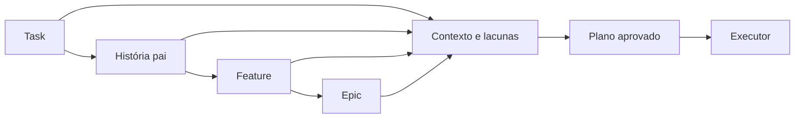
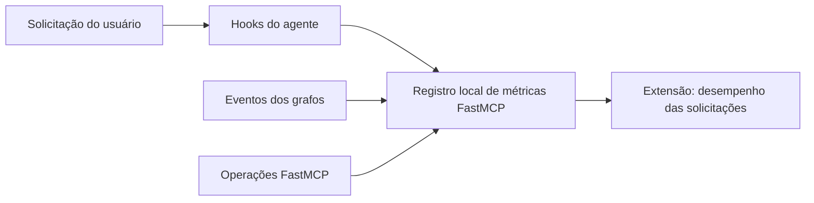
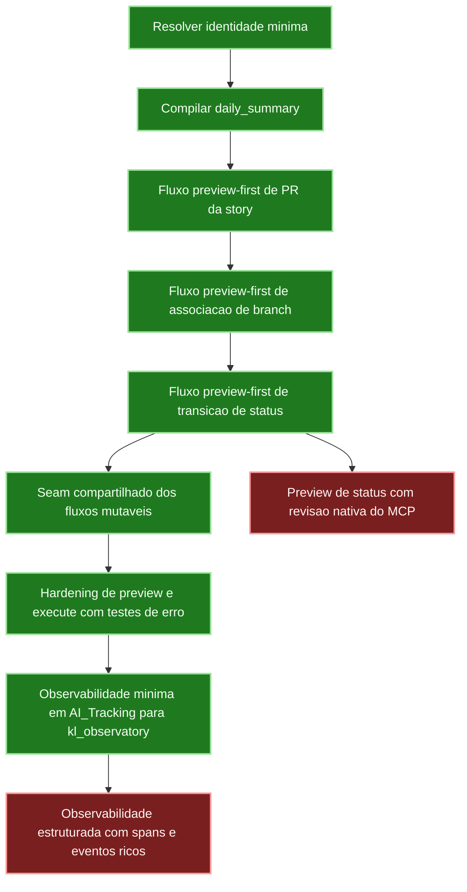

# KwikLedgers LangGraph Runtime

Este repositório orquestra o runtime ativo: LangGraph é dono de processo,
aprovação e replay, enquanto FastMCP fornece as capabilities atômicas nativas.
O `fastmcp` é o único backend suportado; o backend `legacy` foi removido.

A aprovação local usa prévia separada e retomada explícita com
`--approval-request-id`, tanto nos lifecycles quanto nas CLIs de PR, branch,
status e fechamento. Os guardrails e o emissor de capabilities verificam a
mesma confirmação vinculada à ação, prévia, run e request antes da escrita.
Recibos externos não são aceitos; estados antigos com recibo exigem nova prévia.
O host consulta `python -m kwikledgers_langgraph.state_persistence --inspect
<arquivo>` para obter `version: 1`, `pending` e `result`, sem executar o
workflow. No fechamento, `--work-kind fix`, `--fix-summary` e `--origin-task-id`
propagam o contexto da correção para a política existente de Task própria.

A edição supervisionada de conteúdo de uma Task existente reutiliza
`python -m kwikledgers_langgraph.atomic_cli mutation update_work_item_content`.
Para qualquer outro campo simples editável da Task, use
`python -m kwikledgers_langgraph.atomic_cli mutation update_task_fields` com
`work_item_id` e `fields` (mapa de referências Azure para valores escalares).
O FastMCP consulta os campos habilitados no processo e bloqueia tipo, relações,
auditoria e referências não suportadas. A prévia contém os valores atuais e
propostos, tipo, URL de navegação e revisão; os contextos de apresentação nunca
são enviados ao FastMCP. Aprovar exige uma invocação posterior com `--resume
--approval-request-id`, usando o mesmo checkpoint, thread e argumentos.
Alterar o campo aprovado, seu valor atual ou a revisão exige nova prévia. Erro
após envio ou retorno não confirmado resulta em `reconciliation_required`, sem
repetição automática da escrita.

Para lançar horas sem fechar a Task, use o lifecycle oficial
`python -m kwikledgers_langgraph.lifecycle_cli task_hours` com
`--completed-work-hours`, `--story-id`, `--task-id`, repositório, checkpoint e
thread. O fluxo preserva status e `Remaining Work`, cria a prévia com revisão
nativa e exige aprovação explícita em uma retomada separada.
A topologia, os eventos e os nomes de métricas existentes são preservados;
o catálogo operacional deriva o novo campo do schema, sem nova capability.

No `task_cycle`, o plano configurado pelo operador autoriza implementação,
testes e commit locais contínuos. Não há confirmações redundantes para esses
passos. O runtime ainda exige contexto/hierarquia válidos, início de história
concluído, plano inalterado, testes aprovados e a mesma árvore testada antes
do commit. Horas e fechamento mantêm suas prévias e aprovações independentes.
O ciclo aceita `--work-kind fix --fix-summary ... --origin-task-id ...` e
bloqueia implementação sem uma Task própria diferente da origem. Esse contexto
integra checkpoint e prévias; a retomada não pode alterá-lo. O cálculo público
é compartilhado com a prévia de fechamento e não aceita substituir o ceil por
horas arbitrárias; `Remaining Work` ausente não é enviado como zero.

**Migração das entradas isoladas:** `story_pr_cli` e `task_closure_cli` mantêm
consulta/prévia, mas retornam `lifecycle_required` sem oferecer aprovação para
escrita nativa. Use `lifecycle_cli story_completion` para PR e
`lifecycle_cli task_cycle` para execução/fechamento. O payload legado não contém
evidências suficientes para garantir testes, commit, início e associações;
uma confirmação isolada não pode contornar essas exigências. No ciclo oficial,
a PR continua Draft para `stage-pre-prod`, com template do repositório, Mermaid
ao final, URL validada e aprovação independente para `Aguardando PR`. O fechamento
diário (`day_end_closure`) é automático às 18h, como descrito em "Fechamento de tarefas".
As CLIs menores também persistem resultado e reserva por run/request antes
da escrita. Repetir uma aprovação concluída reutiliza seu resultado; uma
tentativa de resultado desconhecido exige reconciliação, sem retry automático.

Após criar uma Task, o lifecycle sincroniza o resumo nativo e consulta o
snapshot persistido para confirmar ID e responsável. Escrita concluída não é
confirmação do snapshot: falha nessa etapa retorna `reconciliation_required`,
preserva o resultado da criação e não cria o item novamente. Isso comprova o
snapshot, não que uma janela da extensão esteja aberta ou já tenha renderizado.
Cada Task filha criada no lifecycle de débito usa a mesma confirmação antes
de oferecer a próxima criação. Responsável explícito integra a prévia; quando
omitido na preparação, a identidade vem da leitura nativa do usuário ativo.
Falha de URL, responsável, sync ou snapshot mantém o item criado e exige
reconciliação, sem recriar o filho nem continuar silenciosamente.

Na preparação de débito, `target_iteration: "next_sprint"` lê a sprint atual
pelo resumo nativo, exige o ano corrente e seleciona a próxima sprint principal
na lista autorizada do operador. Variante de suporte não substitui a principal.
Similaridade e prévia completa são salvas também em
`AI_Tracking/Repo_Work_Item_Context/{technical_debts,technical_debt_previews}/<repo>.json`,
além da evidência do journal. Estados e caches são substituídos atomicamente.

Transições de status continuam sequenciais por padrão. Uma exceção solicitada
pelo usuário usa `--transition-exception-reason` com
`--expected-current-status`; a justificativa integra a prévia e não elimina a
aprovação explícita nem a verificação da revisão nativa.

Saídas de lifecycle incluem `completion`, separando aprovação, estado de
execução, item persistido e snapshot confirmado. O ledger existente recebe
eventos `step` com `node: "workflow_result"` e outcome observado, sem payloads
ou duração inventada. Resultados compartilhados incluem filhos de débito;
reutilizar um resultado já persistido também emite `duplicate_prevented`.
O catálogo declara pré-requisitos, ajuda pública como
contrato de argumentos e critérios de conclusão; isso não valida integrações.

## Configuração operacional para criação

A entrada `work_item_creation_config_cli` consulta os metadados nativos do
processo Azure e prepara o JSON aceito por `work_item_creation_cli
--operator-config`. Requer `AZURE_PROJECT`, `AZURE_PROJECT_AREA`, repositórios
explicitamente selecionados e um servidor FastMCP que exponha
`get_work_item_process_metadata`; a publicação do cliente não publica essa
capacidade no repositório do servidor.

Na raiz deste repositório:

```bash
poetry run python -m kwikledgers_langgraph.work_item_creation_config_cli \
  --repository accountant_frontend=../projects/accountant_frontend \
  --output ../AI_Tracking/operator-creation.json
```

O comando não cria work items nem aprova operações Azure. A saída é um arquivo
local; arquivos existentes só são substituídos com `--replace`, e apenas depois
da leitura bem-sucedida dos metadados. Uma Task é sempre filha do pai informado,
seja qual for o tipo dele (Habilitador Técnico, Technical Debt, Feature etc.);
os demais tipos continuam exigindo uma história como pai. Quando a criação é
bloqueada, o motivo da validação aparece em `errors`. Metadados incompletos ou
indisponíveis bloqueiam a preparação, sem inventar restrições. O fluxo aparece
no catálogo operacional e mantém os eventos e artefatos de observabilidade
existentes; a criação posterior continua sujeita à prévia e aprovação próprias.

## Contexto Da Task

### Handoff da extensão para o Copilot

A continuação cria um registro versão 1 em `Task_Control/handoffs/` antes de
abrir o chat. O marcador identifica apenas esse registro; o hook
`UserPromptSubmit` confirma `accepted` com a sessão real e usa o mesmo ID no
ledger. `PreToolUse` registra `running`. Sem hook carregado, o pedido permanece
`pending`: abrir o chat não comprova aceite.

O handoff contém história, tasks conhecidas, sprint e a restrição `local-only`.
Repositório e branch desconhecidos ficam `null`; o agente deve verificá-los no
checkout vivo antes de editar. Não concede autorização para commits, PRs,
escritas Azure ou eventos `task-completed`.

`Stop` sem conclusão explícita deixa o handoff `blocked`. Depois dos testes, o
agente informa o resultado pela CLI:

```bash
python -m kwikledgers_langgraph.handoff_cli \
  --handoff-id <id> --session-id <sessao> \
  --status completed --tests-passed --evidence "Testes relevantes aprovados."
```

Use `--tracking-root` quando o hook informar uma raiz customizada. Uma nova
solicitação interrompe a associação anterior; não se reutiliza o ID em outra
sessão. Confirmação é operacional local, não atestado independente dos testes.

O ciclo nativo mantém os detalhes da task, da história pai e a hierarquia
Story/Spike/Technical Debt/Bug → Feature → Epic consultada pelo FastMCP.
Descrições, critérios de aceite e lacunas de contexto são preservados no
estado. O plano aprovado inclui `hierarchy_context`; comandos de implementação
e testes recebem esses detalhes como JSON em `KWIKLEDGERS_TASK_CONTEXT`, sem
interpolação de shell. Conteúdo dos itens é contexto de produto, não autorização
para executar ações ou ignorar os gates existentes. Recibos e checkpoints
anteriores devem ser retomados conforme o plano e o contexto que os originaram.



## Catálogo de Grafos

### Métricas por solicitação

Os hooks de `UserPromptSubmit`, `PreToolUse`, `PostToolUse` e `Stop` registram
o ciclo observado de cada solicitação e os passos de ferramentas no arquivo
compartilhado `AI_Tracking/Metrics/request-events.jsonl`. FastMCP fornece o
serviço de persistência; os grafos exportam os eventos operacionais e a extensão
consulta a mesma fonte. Nenhum desses registros autoriza alterações no Azure.



Para correlacionar uma CLI ao pedido do chat, use o ID informado pelo hook em
`KWIKLEDGERS_REQUEST_ID`. Sem um ID explícito, os grafos e operações independentes
não são atribuídos por suposição a outra sessão. Os eventos existentes de
`langgraph-runtime-events.jsonl` mantêm seus nomes e recebem apenas os campos
aditivos `observed_at` e `duration_ms`, preservando o consumo pelo observatório.

Os intervalos dos nós são medidos entre timestamps de eventos, não representam
CPU ou execução exclusiva do nó. O tempo total inclui esperas; passos aninhados
não devem ser somados ao total da solicitação. Sem início conhecido, a duração
fica ausente. `Stop` encerra a medição da resposta, não comprova sucesso da
task. Uma nova solicitação interrompe a anterior que não recebeu encerramento.
Sem `PostToolUse` observado, não se inventa conclusão nem duração da ferramenta.

O hook não persiste prompts nem argumentos/resultados de ferramentas; apenas
identificadores, nomes, status e durações. Justificativas são resumos
operacionais baseados em evidências, não raciocínio interno privado. Os eventos
de grafos são exportados ao retornar à CLI; se o processo terminar antes disso,
o hook pode registrar a execução externa, mas não há garantia de exportação dos
nós internos. Novos hooks precisam ser carregados pela sessão do editor;
instalar uma extensão não comprova que o host de agentes os carregou.

O cliente propaga o contexto explícito por MCP `_meta` usando o contrato
`kwikledgers/context` versão `1`, sem misturá-lo ao payload aprovado.
`KWIKLEDGERS_WORKSPACE_ID`, `KWIKLEDGERS_SESSION_ID`, `KWIKLEDGERS_RUN_ID` e
`KWIKLEDGERS_SPAN_ID` complementam o request ID quando conhecidos. Cada chamada
recebe um span filho próprio; correlação não substitui aprovação.

`python -m kwikledgers_langgraph.graph_catalog` retorna JSON com nós, conexões,
fontes e Mermaid de 12 topologias reais, extraídas por `get_graph()` das fábricas.
Não executa grafos, não registra assistants executáveis e não usa os mocks do
Studio. Portas de inspeção bloqueiam qualquer chamada de integração; o
checkpointer é somente em memória. Não exige credenciais Azure nem servidor.

A extensão VS Code usa esse catálogo na seção **K > Grafos do LangGraph**.
Criação de itens, mutações atômicas e execução de débito dependem de argumentos
ou evidência preparada e não recebem uma topologia fictícia neste catálogo.
O catálogo não expõe estados, recibos ou payloads operacionais. É uma superfície
de inspeção, não substitui os eventos e traces do runtime no observatório.

### Descoberta de entradas públicas

`python -m kwikledgers_langgraph.graph_catalog --operational` retorna um
catálogo JSON versão `1`, separado da lista de topologias consumida pela
extensão. Ele lista os módulos CLI declarados, comandos de ajuda, efeitos
possíveis, modalidade de aprovação e opção de retomada. Os campos de argumentos
atômicos vêm dos schemas existentes; não substituem as validações dos workflows
nem as restrições do processo Azure.

Grafos sem entrada pública, como `process_snapshot`, têm `entry_point: null`
e `entry_status: "not_exposed"`. Entradas declaradas permanecem com
`runtime_status: "not_checked"`: descoberta não testa credenciais, transporte,
aprovações, disponibilidade externa ou execução real. `integration_checks`
permanece `"not_performed"`, e nenhuma integração ou workflow é executado.

As capacidades reservadas a lifecycle aparecem separadamente, com execução
atômica direta desabilitada. O catálogo não encaminha operações, concede
aprovação nem habilita capacidades ausentes. A invocação sem argumentos mantém
o formato de lista das 12 topologias. Cada topologia também fornece o campo
aditivo `operation`, com os mesmos metadados usados pelo painel de grafos.
Consumidores anteriores podem ignorar esse campo; consumidores novos devem
aceitar sua ausência ao consultar versões antigas do runtime.

## Modo de repositorio standalone

O projeto foi estruturado para viver como um repositório próprio no GitHub.

- O codigo-fonte vive sob `kwikledgers_langgraph/`.
- A validacao basica vive sob `tests/`.
- O unico backend de integracao e o `fastmcp` (`kwikledgers_fastmcp`).

Variaveis de ambiente suportadas:

- `KWIKLEDGERS_USER_EMAIL`: email explicito do usuario atual para o seam de identidade do runtime novo.
- `KWIKLEDGERS_USER_DISPLAY_NAME`: nome exibido do usuario atual quando a identidade for resolvida por ambiente.

Tracking nativo:

- `KWIKLEDGERS_AI_TRACKING_ROOT`: diretório de tracking explícito, com precedência.
- `KWIKLEDGERS_ROOT_DIR`: workspace; resolve `AI_Tracking` quando não há raiz explícita.
- `KWIKLEDGERS_ENV_FILE`: arquivo de ambiente do runtime nativo, também usado
	para configurar a assinatura das notificações solicitadas pela CLI de fechamento.

## Estrutura inicial

- `kwikledgers_langgraph/state.py`: contrato tipado do estado compartilhado
- `kwikledgers_langgraph/adapters.py`: portas/protocolos para integracoes
- `kwikledgers_langgraph/fastmcp_adapters.py`: adapters das capabilities nativas do FastMCP
- `kwikledgers_langgraph/guardrails.py`: gates explicitos de aprovacao e classificacao de operacoes
- `kwikledgers_langgraph/observability.py`: correlation ID, run ID e timeline da execucao
- `kwikledgers_langgraph/graphs/mutable_flow.py`: seam compartilhado para fluxos mutaveis preview-first
- `kwikledgers_langgraph/graphs/daily_summary.py`: primeiro subgrafo
- `kwikledgers_langgraph/graphs/story_pull_request.py`: fluxo de preview/aprovacao/criacao de PR da story
- `kwikledgers_langgraph/graphs/story_pr_launch.py`: lancamento da PR Draft de branch ja publicada (checklist, preview, aprovacao, criacao e verificacao); CLI `python -m kwikledgers_langgraph.story_pr_launch_cli`
- `kwikledgers_langgraph/graphs/story_pr_publish.py`: tira a PR ativa da historia de Draft (preview, aprovacao, guarda do commit de origem e verificacao); CLI `python -m kwikledgers_langgraph.story_pr_publish_cli`
- `kwikledgers_langgraph/graphs/story_pr_cherry_pick.py`: cherry-pick sem merge de uma PR ativa para `stage-homolog` (uma PR por execucao) pela API do Azure; em conflito ou falha usa worktree dedicado em `./worktrees` (`story_pr_worktree.py`), preservado para resolucao manual e retomado de forma idempotente, sem abort, reset ou force; CLI `python -m kwikledgers_langgraph.story_pr_cherry_pick_cli`. A PR da branch `cherry-pick/KL-<id>-...` para o alvo sai por `story_pr_launch --target-branch stage-homolog`
- `kwikledgers_langgraph/graphs/story_branch_association.py`: fluxo de preview/aprovacao/associacao de branch da story
- `kwikledgers_langgraph/graphs/story_status_transition.py`: fluxo de preview/aprovacao/transicao de status da story
- `kwikledgers_langgraph/runtime.py`: fabrica de compilacao do runtime
- `kwikledgers_langgraph/cli.py`: entrypoint manual do novo runtime
- `kwikledgers_langgraph/story_pr_cli.py`: entrypoint dedicado ao fluxo de PR da story
- `kwikledgers_langgraph/story_branch_cli.py`: entrypoint dedicado ao fluxo de associacao de branch da story
- `kwikledgers_langgraph/story_status_cli.py`: entrypoint dedicado ao fluxo de transicao de status da story

## Execucao manual

O resumo operacional da extensão usa esta mesma CLI, sem iniciar `langgraph dev`
ou FastMCP HTTP. `--sprint-path` e `--story-id` selecionam o contexto no provider
oficial. `--json` retorna apenas o envelope versão `1` (`operation`, `context`,
`status`, `result`); falhas retornam código diferente de zero.
`--standalone-request` registra o ciclo próprio de uma consulta independente do
chat; não deve ser usado para duplicar o ciclo já controlado pelos hooks.
Uma execução do resumo compartilha uma sessão MCP e encerra o processo stdio
ao terminar, inclusive em falhas. Chamadas avulsas continuam suportadas.
Timeouts de mutações continuam com resultado desconhecido, sem retry automático.

Instale as dependencias do ambiente com Poetry:

```bash
poetry install
```

Quando as dependencias declaradas em `pyproject.toml` mudarem, regenere e versione
tambem o `poetry.lock`:

```bash
poetry lock
```

```bash
poetry run kwikledgers-langgraph --help
```

```bash
poetry run kwikledgers-langgraph-story-pr --help
```

```bash
poetry run kwikledgers-langgraph-story-branch --help
```

```bash
poetry run kwikledgers-langgraph-story-status --help
```

## Fechamento de tarefas

O fluxo `day_end_closure` lança as horas da task ativa, fecha-a e cria a
continuação igual sem aprovação separada (exceção autônoma do workspace), às 18h
pelo agendamento ou sob demanda. Com `--dry-run` gera somente a prévia, sem
escrita no Azure. Evidência de atividade e testes aprovados continuam sendo
pré-requisito da execução.

```bash
poetry install
poetry run kwikledgers-langgraph-day-end-closure --trigger manual --backend fastmcp --timezone America/Sao_Paulo --dry-run
```

O gerador `scripts/register-day-end-closure.sh` agenda o fechamento automático às 18h,
de segunda a sexta, e exige cron, os dois runtimes locais e o fuso de São Paulo.
O arquivo de ambiente deve ser absoluto, existente e legível, sem `%` ou quebra
de linha; o padrão é `kwikledgers_fastmcp/.env`. A instalação do agendamento é
uma ação operacional separada.
Sem atividade vinculada à task, o fechamento é ignorado (`no_task_activity`); várias tasks ativas sem
seleção explícita impedem a seleção automática. A CLI usa FastMCP por padrão,
inclusive quando chamada por consumidores que não selecionam um backend.

O hook de conclusão exige testes aprovados, evidência separada de trabalho e
evento da mesma sessão. Usa o horário registrado da conclusão e bloqueia sessões
de implementação somente local. O hook resolve tracking sem importar runtimes externos
e bloqueia journals incompletos. Escritas aprovadas em outros fluxos usam revisão
nativa e journal durável; resultados desconhecidos exigem reconciliação.

Na extensão, alertas de ociosidade estão habilitados. A continuação usa apenas
arquivos locais, sem commit, push, PR ou alteração no Azure.

## Validacao rapida

```bash
poetry run python -m unittest discover -s tests
```

## Interface visual (LangGraph Studio local)

O projeto usa um único ambiente Poetry (Python 3.12+) que já inclui
`langgraph-cli[inmem]` como dependência declarada em `pyproject.toml`. O
Studio local sobe direto pelo mesmo `.venv` do projeto, sem venv separado,
e usa apenas ports mockados (nunca os adapters reais) definidos em
`kwikledgers_langgraph/dev_studio.py`.

O pacote irmão `kwikledgers-fastmcp` é uma dependência Python declarada para
os contratos de correlação, tracking e handoff compartilhados. A instalação
resolve também suas dependências, sem iniciar nem importar seu servidor.
O transporte stdio continua usando o Python do ambiente separado
`kwikledgers_fastmcp/.venv`, ou o comando explicitamente configurado.
A CI verifica processos separados e ausência dos módulos do servidor no
cliente, não a ausência de bibliotecas instaladas exigidas pelo pacote.

Passos:

```bash
poetry install
poetry run langgraph dev
```

Isso sobe um servidor local com os grafos declarados em `langgraph.json`
(`daily_summary`, `story_pull_request`, `story_branch_association`,
`story_status_transition`), usando ports mockados definidos em
`kwikledgers_langgraph/dev_studio.py` (nunca os adapters reais).
O terminal mostra a URL do Studio (`https://smith.langchain.com/studio/?baseUrl=http://127.0.0.1:8123`)
para abrir a UI interativa no navegador.

## Roadmap Visual



- Verde: slices implementados e validados.
- Vermelho: backlog restante relevante.

Exemplo de execucao:

```bash
poetry run kwikledgers-langgraph --backend fastmcp --disable-notifications
```

## Guardrails e observabilidade

O runtime novo agora registra em codigo:
- classificacao explicita das operacoes por tipo
- decisao de guardrail para cada etapa do fluxo
- `correlation_id` e `active_run_id` por execucao
- timeline de eventos por node no estado compartilhado
- emissao opcional de um resumo operacional em `AI_Tracking/Metrics/ai-usage-log.md`, consumivel pelo `kl_observatory`

O fluxo `daily_summary` agora tambem aceita um seam real de identidade:
- preserva `user_identity` quando ela ja vem do estado
- tenta resolver apenas nome e email explicitamente fornecidos por adapter configurado
- evita persistir email bruto em tracking e timeline, registrando apenas flags operacionais sobre a resolucao

As operacoes mutaveis de Azure ficam reservadas para fluxos futuros com
aprovacao explicita; o `Daily Summary` atual e classificado como fluxo sem
mutacao Azure, mas ja passa pela mesma camada de guardrails.

O primeiro fluxo mutavel agora existe para PR de story, mas segue preview-first:
- o preview da PR e sempre executado como leitura
- o runtime emite um `pending_approval` com `request_id` proprio para o preview atual
- a criacao da PR so segue quando uma `approval_confirmation` separada reaproveita esse `request_id`, o preview anterior e o `active_run_id` da execucao
- a CLI operacional nunca emite aprovacao automatica; a retomada exige confirmacao humana vinculada ao estado salvo

O fluxo de associacao de branch da story segue o mesmo contrato preview-first:
- o preview da associacao sempre roda como leitura
- o runtime persiste `branch_association_preview`, `pending_approval.request_id` e `observability.active_run_id`
- a associacao real so acontece quando uma retomada explicita usa o mesmo arquivo de estado salvo e o mesmo `request_id`
- a CLI operacional exige retomada com confirmacao humana para executar a associacao

O fluxo de transicao de status da story segue o mesmo contrato preview-first:
- o preview da transicao sempre roda como leitura e valida a proxima etapa do fluxo canonico
- o runtime persiste `story_status_preview`, `pending_approval.request_id` e `observability.active_run_id`
- a execucao real revalida status atual e revisao sintetizada antes de aplicar a mudanca
- a CLI operacional exige retomada com confirmacao humana para executar a transicao

Os tres fluxos mutaveis agora compartilham o mesmo seam interno:
- validacao minima de request obrigatorio
- preview read-only com tratamento uniforme de falha de adapter
- approval gate padronizado com `request_id`, `preview` e `active_run_id`
- execute com tratamento uniforme de falha e resultado operacional minimo

Os estados salvos de fluxos mutáveis exigem `KWIKLEDGERS_LANGGRAPH_STATE_SIGNING_KEY`:
- previews e retomadas são persistidos em envelope HMAC-SHA256
- branch, PR, status e fechamento não aceitam arquivo mutável sem assinatura
- as flags `--approve-*` não fazem parte da superfície operacional; a simulação existe apenas nos testes diretos de grafo

Quando um backend FastMCP mutável estiver ativo, o LangGraph emite uma capability HMAC curta após o approval gate. Ela vincula a tool FastMCP, o digest do payload, o `request_id`, o `active_run_id` e a expiração; o FastMCP apenas valida esse vínculo antes de executar a primitiva atômica.

No FastMCP, a retomada exige `--receipt` com recibo humano assinado produzido
fora do runtime, após a prévia. O emissor revalida recibo, ação, payload exato
e contexto autenticado; o token não pode ultrapassar a validade do recibo.
`--approval-request-id` sozinho serve apenas à compatibilidade legada explícita.
Não crie recibos no processo operacional para contornar esse contrato.

Observabilidade externa minima:
- por padrao, as CLIs gravam um resumo curto da execucao em `AI_Tracking/Metrics/ai-usage-log.md`
- esse resumo reaproveita o formato que o `kl_observatory` ja parseia, sem acoplar o runtime ao banco/API do observatory
- use `--disable-observability-sync` quando quiser rodar a CLI sem emitir esse evento externo

Fluxo operacional da CLI de PR da story:

```bash
poetry run kwikledgers-langgraph-story-pr \
	--story-id 120204 \
	--repository-name accounting \
	--source-branch feature/KL-120204-balance-sheet-by-class \
	--what-was-changed "Resumo formal da alteracao" \
	--affected-processes "Fluxo de PR da story" \
	--expected-impacts "Maior previsibilidade do runtime" \
	--important-points "Validar preview e aprovacao" \
	--mermaid-diagram "graph TD; A-->B;" \
	--save-state-file /tmp/story-pr-preview.json \
	--print-state
```

- o primeiro comando gera o preview e grava o estado final completo, incluindo `pull_request_preview`, `pending_approval.request_id` e `observability.active_run_id`
- a aprovacao humana deve acontecer fora do runtime e referenciar o `request_id` exibido no estado salvo

```bash
poetry run kwikledgers-langgraph-story-pr \
	--resume-state-file /tmp/story-pr-preview.json \
	--receipt /tmp/host-pr-receipt.json \
	--save-state-file /tmp/story-pr-final.json \
	--print-state
```

- o segundo comando reaproveita o mesmo estado serializado para preservar preview, `request_id` e `active_run_id`
- a retomada real depende desse mesmo arquivo de estado; reiniciar a CLI com um estado novo invalida o vinculo exigido pelo guardrail

Fluxo operacional da CLI de associacao de branch da story:

```bash
poetry run kwikledgers-langgraph-story-branch \
	--story-id 120204 \
	--repository-name accounting \
	--source-branch feature/KL-120204-balance-sheet-by-class \
	--save-state-file /tmp/story-branch-preview.json \
	--print-state
```

- o primeiro comando gera o preview e grava o estado final com `branch_association_preview`, `pending_approval.request_id` e `observability.active_run_id`

```bash
poetry run kwikledgers-langgraph-story-branch \
	--resume-state-file /tmp/story-branch-preview.json \
	--receipt /tmp/host-branch-receipt.json \
	--save-state-file /tmp/story-branch-final.json \
	--print-state
```

- a retomada da associacao real exige o mesmo arquivo de estado e o `request_id` aprovado externamente

Fluxo operacional da CLI de transicao de status da story:

```bash
poetry run kwikledgers-langgraph-story-status \
	--story-id 120204 \
	--target-status "Aguardando PR" \
	--expected-current-status "Desenvolvimento" \
	--save-state-file /tmp/story-status-preview.json \
	--print-state
```

- o primeiro comando gera o preview e grava o estado final com `story_status_preview`, `pending_approval.request_id` e `observability.active_run_id`

```bash
poetry run kwikledgers-langgraph-story-status \
	--resume-state-file /tmp/story-status-preview.json \
	--receipt /tmp/host-status-receipt.json \
	--save-state-file /tmp/story-status-final.json \
	--print-state
```

- a retomada da transicao real exige o mesmo arquivo de estado e o `request_id` aprovado externamente

## Proximo passo natural

Evoluir a emissao de observabilidade minima para sinais mais ricos no stack,
sem perder o contrato enxuto de preview, tracking e timeline.

## Processos de Lifecycle

Os novos processos são isolados dos builders e CLIs existentes. Nenhum backend
Azure, git, FastMCP ou executor de código está conectado automaticamente.
As CLIs operacionais recebem configuração e planos explícitos do operador.
Os testes locais passaram; mocks não comprovam paridade operacional externa.
Consulte a [evidência de validação](docs/native-runtime-validation-2026-10-09.md):
408 testes LangGraph e 139 FastMCP, com os gates externos ainda abertos.

Builders públicos:

- `graphs.story_lifecycle.build_story_start_graph(ports, checkpointer=...)`:
	horário local primeiro, prévia de atribuição/Area/Active, aprovação humana,
	seleção de feature/hotfix, prévia e aprovação da branch a partir do HEAD
	remoto de stage-pre-prod, associação aprovada do pai e das children.
- `graphs.story_lifecycle.build_story_completion_graph(ports, checkpointer=...)`:
	vínculos aprovados, prévia e aprovação da PR Draft usando template/Mermaid,
	URL direta no resultado, nova aprovação independente de Aguardando PR.
- `graphs.task_lifecycle.build_task_cycle_graph(ports, checkpointer=...)`:
	evidência de início concluído, plano aprovado, implementação, testes,
	commit aprovado, horário de fechamento, horas com ceil e aprovação,
	prévia e aprovação independentes de Closed. Remaining Work não é enviado.
- `graphs.technical_debt_preparation.build_technical_debt_preparation_graph(ports)`:
	similaridade, contexto local, HTML seguro, Fibonacci, prévia completa de
	pai/filhas e cache quando houver indício de implementação. Não cria itens.
- `graphs.process_snapshot.build_process_snapshot_graph(ports)`:
	separação técnico/frontend/operacional, bloqueios/devoluções, todos os tipos
	e estados de tasks, e recomendações de cadência de prazos. Não agenda nem
	envia notificações.

As três orquestrações mutáveis também estão no registry independente
`lifecycle_runtime.LIFECYCLE_BUILDERS`; a fábrica é `build_lifecycle_runtime`.
Não houve alteração do registry existente de runtime, das CLIs ou do Studio.

Exemplo de ida e retomada, com portas e checkpointer fornecidos pelo host:

```python
from langgraph.types import Command
from kwikledgers_langgraph.lifecycle_runtime import build_lifecycle_runtime

graph = build_lifecycle_runtime("story_start", ports, checkpointer=trusted_checkpointer)
config = {"configurable": {"thread_id": authorized_thread_id}}
result = graph.invoke({"request": {
		"story_id": story_id,
		"task_id": child_id,
		"repository_name": repository_name,
}}, config)
pending = result["pending_approval"]
result = graph.invoke(Command(resume=authenticated_human_receipt), config)
```

Após a aprovação de Active, a próxima interrupção solicita a seleção explícita:
`graph.invoke(Command(resume="feature"), config)` ou `"hotfix"`. Os próximos
gates exigem recibos novos vinculados às respectivas prévias. Uma rejeição
encerra o processo; não há aprovação automática nem bypass de produção.

`LifecyclePorts`, `TechnicalDebtPreparationPorts` e `ProcessSnapshotPorts`
estão em `adapters.py`. O host deve implementar autenticação/autorização de
threads e recibos, revalidação CAS, allowlist de repositórios, planos confiáveis,
idempotência por chave e tracking durável em AI_Tracking. `MemorySaver` serve
para testes locais, não para persistência operacional.

```bash
poetry run python -m unittest discover -s tests -p 'test_lifecycle*.py'
poetry run python -m unittest discover -s tests -p 'test_process_policy.py'
poetry run python -m unittest discover -s tests
```